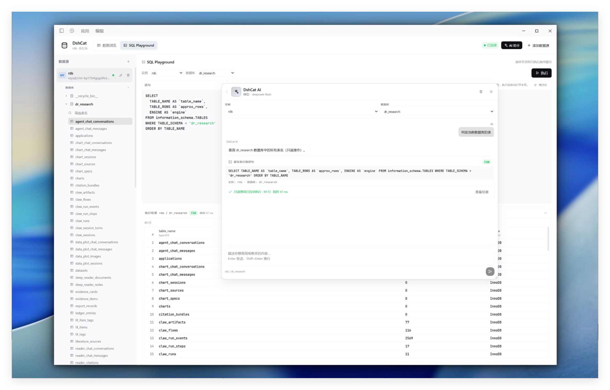
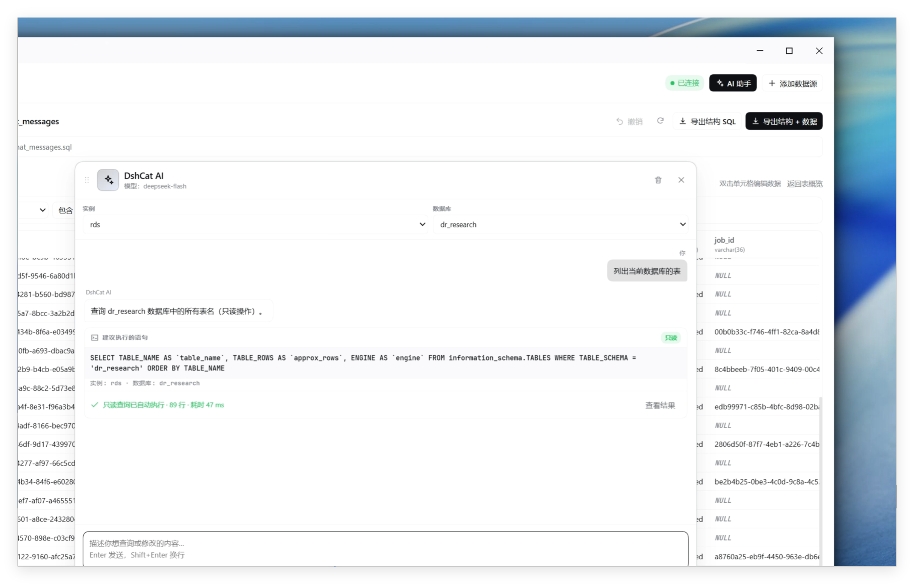
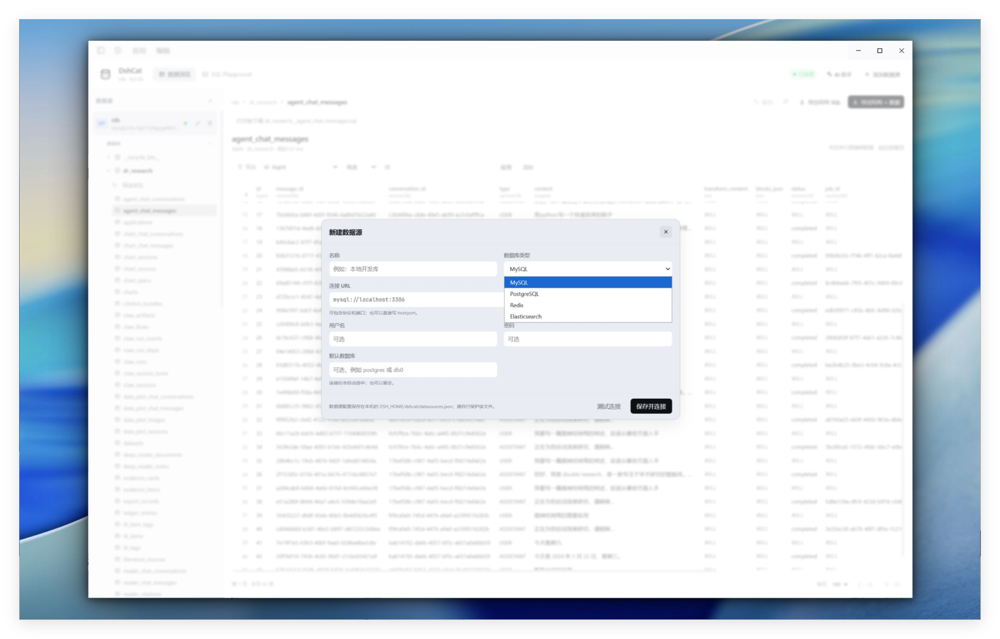
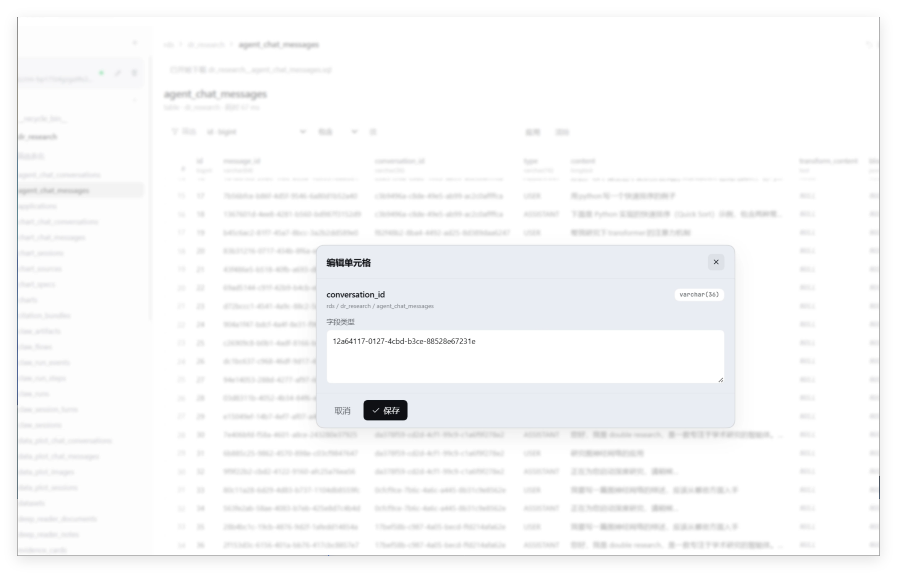
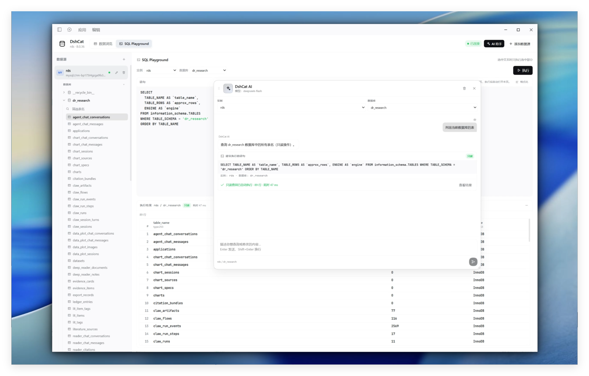
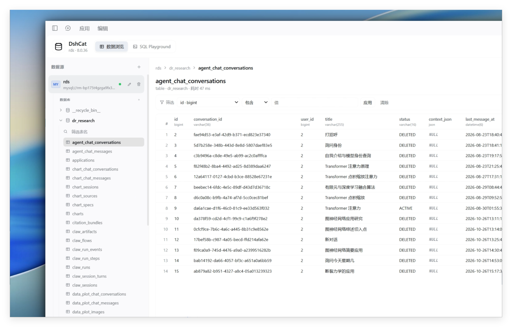

# DshDataCat

**English** | [简体中文](README.zh.md)

[](LICENSE)
[](#requirements)
[](#installation)
[](#support-matrix)
[](#contributing)

DshDataCat is a DeepSeek Harness (DSH) plugin that adds a AI copilot style database workspace to the sidebar. It runs in DSH Web and DeepSeek Harness Desktop (`deepseek-harness-app`) and supports MySQL, PostgreSQL, Redis, and Elasticsearch. It includes table browsing, type-aware cell editing with undo, database management, SQL Playground, data exports, and a page-scoped AI assistant.

Database connections are made by the DSH Host. The browser calls the Host through DSH's authenticated same-origin session.

## Screenshots

<table>
  <tr>
    <td width="50%" align="center">
      <a href="img/img1.png"></a><br>
      <sub>SQL Playground with the AI assistant</sub>
    </td>
    <td width="50%" align="center">
      <a href="img/img2.png"></a><br>
      <sub>AI copilot generating and running a read-only query</sub>
    </td>
  </tr>
  <tr>
    <td width="50%" align="center">
      <a href="img/img3.png"></a><br>
      <sub>Connect MySQL, PostgreSQL, Redis, or Elasticsearch</sub>
    </td>
    <td width="50%" align="center">
      <a href="img/img4.png"></a><br>
      <sub>Type-aware cell editing with primary-key context</sub>
    </td>
  </tr>
  <tr>
    <td width="50%" align="center">
      <a href="img/img5.png"></a><br>
      <sub>Generated SQL and query results in the playground</sub>
    </td>
    <td width="50%" align="center">
      <a href="img/img6.png"></a><br>
      <sub>Table browser with filters, field types, and pagination</sub>
    </td>
  </tr>
</table>

<sub>Screenshots were captured before the DshCat → DshDataCat rename; some UI labels still show the previous name.</sub>

## Features

### Connect and browse

- Add MySQL, PostgreSQL, Redis, and Elasticsearch sources with a connection URL, username, password, and optional default database.
- Browse `instance → database → table`; click a database to expand its tables and click again to collapse.
- Click a column header to target it in the filter bar; page through rows with 50, 100, or 200 rows per page.
- Filter tables by name and inspect column types and primary-key information.

### Database management

- Create a database on MySQL/PostgreSQL connections.
  - MySQL: `utf8mb4` with `utf8mb4_unicode_ci`.
  - PostgreSQL: `UTF8`.
- Drop the current database, but only after typing the exact confirmation phrase `确认删除<database-name>`.
- System databases are protected in the UI, the Host API, and SQL Playground:
  - MySQL: `mysql`, `information_schema`, `performance_schema`, `sys`
  - PostgreSQL: `postgres`, `template0`, `template1`

### Table data

- Field filters, pagination, and column-header shortcuts.
- Double-click a cell in a MySQL/PostgreSQL table to edit it:
  - Type-aware editors for numbers, booleans, MySQL enums, dates/times, JSON/arrays, and text.
  - Nullable columns support explicitly setting `NULL`.
  - The editor shows the field type, primary-key marker, and current instance/database/table.
- Keep the last three manual cell edits per table; the toolbar Undo button restores newest-to-oldest and shows how many undo steps remain.
- Cell updates use the primary key to identify the row (composite keys supported). Tables without a primary key, views, binary fields, and Redis/Elasticsearch virtual tables are read-only.

### SQL Playground

- Runs against the current instance and database. With a selection, only the selection runs; otherwise the whole editor runs.
- `Ctrl/Cmd + Enter` runs the statement. The result pane can be resized or minimized.
- SQL syntax highlighting is rendered by an overlay that stays in sync with the native textarea, preserving selection, typing, paste, and IME behavior.
- MySQL/PostgreSQL support a Format button that formats the selection, or the whole editor when there is no selection.
- Risk checks require confirmation before writes, DDL, and Redis delete commands. Result sets are capped at 2,000 rendered rows.
- Results remember the source instance/database and warn when they are stale for the current context.

### AI assistant

- The AI entry point and chat window appear only inside the DshDataCat page, never on other conversation pages.
- The window can be moved by its title bar and resized from its four corners; on narrow screens it becomes a bottom sheet inside the panel.
- Reads the current database schema and a small sample of values to generate queries and explain risk.
- Read-only queries run automatically and open SQL Playground for results. Writes and other high-risk statements require confirmation.
- When SQL execution fails, the error is added to the AI conversation history as an execution-error event so you can ask follow-up repair questions.
- Uses the current default DSH model.

### Exports

- MySQL/PostgreSQL: export table DDL, or DDL plus data.
- Redis: export a key/value command script.
- Elasticsearch: export mapping JSON or NDJSON.
- Export limits: 50,000 SQL rows, 1,000 Redis keys, and 10,000 Elasticsearch documents. Exported files include a note when a limit is reached.

## Support matrix

| Source | Browse tables/data | Filter and paginate | Cell editing | Create/drop databases | SQL execution | Export |
| --- | --- | --- | --- | --- | --- | --- |
| MySQL | Yes | Yes | Tables with a primary key | Yes | Yes | DDL / DDL + data |
| PostgreSQL | Yes | Yes | Tables with a primary key | Yes | Yes | DDL / DDL + data |
| Redis | Keys virtual table | Key/type filter, pagination | No | No | Redis commands | Command script |
| Elasticsearch | Indices / Documents | Pagination | No | No | SQL / JSON DSL | Mapping / NDJSON |

## Requirements

- A DSH Web or DeepSeek Harness Desktop version with Cordis plugin support.
- Node.js 20 or newer on the DSH Host.
- pnpm when installing or developing from source.
- The plugin bundles its database drivers: `mysql2`, `pg`, `redis`, and `@elastic/elasticsearch`.

## Installation

### DeepSeek Harness Desktop (`deepseek-harness-app`)

This is the recommended method for the official DeepSeek Harness Desktop app. No standalone `dsh` command is required.

1. Install and open DeepSeek Harness Desktop.
2. Prepare the plugin directory:

   ```sh
   git clone <repository-url> dshcat
   cd dshcat
   pnpm install
   ```

   If you downloaded a source archive instead, extract it and run `pnpm install` inside the extracted `dshcat` directory.

3. In DeepSeek Harness Desktop, open **Plugins** and click **Add plugin**.
4. Select the `dshcat` directory containing `package.json` and `cordis.patch.yml`, then wait for installation.
5. Confirm that **DshDataCat** is enabled. Enable it from the plugin list if necessary.
6. Start a new session, or refresh/restart the app. **DshDataCat** appears in the sidebar.

Local directory installs are linked, so **do not move or delete the `dshcat` directory** after installation. If you move it, remove and re-add the plugin in Plugins. Run `pnpm install` in the directory after updating dependencies.

### Local directory installation (general)

For DSH Web or a manually managed profile, use **Plugins → Add plugin** and select this directory. The internal bundle name remains `@local/dshcat`; the visible plugin name is **DshDataCat**. Open **DshDataCat** from the sidebar after starting a new session or refreshing the page.

### Updating during development

`client.js` is loaded directly by the DSH Web client; there is no build step.

1. Edit `client.js`, files under `lib/`, or other plugin files.
2. Reload the DshDataCat plugin, or disable and enable it in Plugins.
3. Refresh DSH so the browser loads the new client bundle.

## Quick start

1. Open **DshDataCat → Add data source** in the sidebar.
2. Choose a source type and enter a connection URL:

   ```text
   mysql://localhost:3306/app
   postgresql://localhost:5432/postgres
   redis://localhost:6379/0
   http://localhost:9200
   ```

   Username and password are optional. For Redis, `/0` is the database index, not a path.

3. Save and connect, then choose a database and table.
4. Run SQL in SQL Playground, or open **AI assistant** from the page header and describe what you need.

> Redis uses port **6379** by default. If the connection is refused, confirm that the service is running and the port is correct. DshDataCat now reports the target address and the underlying connection error.

## Data and security

- Source settings are stored on the Host at:

  ```text
  DSH_HOME/dshcat/datasources.json
  ```

  `DSH_HOME` defaults to `~/.dsh`.

- **Passwords and URL credentials are stored in plaintext in that file.** Restrict its permissions and never commit it, sync it, or include it in screenshots.
- The browser receives sanitized source metadata. Credentials and database connections stay on the Host.
- AI requests send the current schema and a few sample values to the current DSH default model. This can include Redis key/value previews and Elasticsearch sample documents. Switch to a non-sensitive database or avoid the AI assistant when that data must not leave the machine.
- Writes, DDL, and Redis delete commands require confirmation before execution. You remain responsible for your databases.
- `DROP DATABASE` statements targeting protected system databases are rejected by the Host, including statements from SQL Playground and AI-generated SQL.

## Project structure

```text
dshcat/
├── index.js                Host entry: registers /api/dshcat
├── lib/
│   ├── api.js              Authenticated API dispatch, validation, result caps
│   ├── ai.js               AI prompt, schema context, model call
│   ├── store.js            Reads/writes DSH_HOME/dshcat/datasources.json
│   ├── sql.js              Identifiers, filters, risk checks, SQL/Redis literals
│   ├── url.js              URL parsing, sanitization, connection info
│   └── adapters/           MySQL / PostgreSQL / Redis / Elasticsearch adapters
├── client.js               Web client bundle (UI, store, SQL editor, AI panel)
├── locale/                 Plugin-list metadata (English and Chinese)
├── img/                    README screenshots
├── icon.svg                Sidebar icon
├── cordis.patch.yml        DSH bundle insertion point
├── scripts/check.mjs       Syntax check for all JavaScript files
├── package.json
├── LICENSE                 MIT license
├── README.md               English README (default)
└── README.zh.md            Chinese README
```

- `client.js` is a single browser bundle using `React.createElement` and plain CSS. It intentionally has no build chain.
- UI copy lives in the `COPY` table in `client.js`; plugin-list metadata lives in `locale/*.json`. New features may require updating both.
- Adapters implement a shared contract and are registered in `lib/adapters/index.js`.
- The browser never imports database drivers; all driver dependencies are used by the Host half.

## Development

```sh
pnpm install
pnpm check
```

`pnpm check` runs `node --check` on every JavaScript file in the repository; it does not start a database or DSH.

The repository does not include database integration tests. When changing an adapter, run a manual regression against temporary MySQL, PostgreSQL, Redis, and Elasticsearch instances covering connect, query, edit, and export flows.

Before committing:

- Do not add `node_modules/`, `.tmp*`, logs, `.env`, or `datasources.json`.
- Keep `client.js` loadable by the browser without Node built-ins (`fs`, `path`, etc.).
- Use DSH theme tokens (`--dsw-*`) for UI styling instead of hard-coded light/dark colors.
- Update this README's security notes when changing credential or source behavior.

## Known limitations

- Cell editing and database creation/deletion are available only for MySQL/PostgreSQL. Cell editing requires a primary key; binary fields are read-only.
- The cell undo stack lives in the current browser session and is cleared by a refresh or plugin reload. It does not detect concurrent SQL changes to the same cell.
- PostgreSQL DDL export includes columns, defaults, and primary keys, but not complete foreign keys, triggers, or custom type definitions.
- SQL results are capped at 2,000 rendered rows per result set. Export limits are separate.
- Redis reads keys with `SCAN`; page order can change when the keyspace changes. Key filters support contains/equals, and type filtering supports equality.
- Elasticsearch SQL requires the SQL feature to be enabled on the cluster. JSON DSL is also available for the current index.
- Redis displays `db0`, `db1`, … as databases and `Keys` as a virtual table. Elasticsearch displays indices as databases and `Documents` as a virtual table.
- There is no SSH tunnel, certificate-file picker, or connection-pool management UI. SSL options are expressed through the URL using `sslmode` / `tls`.
- The SQL formatter is lightweight and not a complete SQL parser. Review complex statements after formatting.
- The AI assistant is available only inside the DshDataCat page and depends on the configured DSH default model.

## Troubleshooting

### Redis connection refused / `ECONNREFUSED`

Confirm that Redis is running and check the URL port. The default is `6379`, not `3679`. DshDataCat now shows the target address and the underlying connection error.

### MySQL/PostgreSQL connection failed

Check the Host, port, firewall, credentials, permissions, and whether the default database exists. Leave the default database blank or create it first when needed.

### AI assistant does not appear

The AI entry point is in the DshDataCat header only. Configure the DSH default model and select an instance and database on the page.

### The page does not reflect changes

Reload the DshDataCat plugin in Plugins, then refresh the page. The client bundle is loaded with the page, so reloading the plugin alone may not replace already-loaded JavaScript.

## Contributing

Issues and pull requests are welcome.

- Run `pnpm check` before submitting.
- Do not commit `node_modules/`, `.tmp*`, `.env`, or any `datasources.json`.
- Update the README security notes when changing database adapters or credential behavior.
- Describe the purpose, affected data sources, and verification scope in a pull request.

## GitHub Topics

Recommended topics for the repository's **About → Topics** section:

```text
dsh
dsh-plugin
deepseek-harness
database-manager
mysql
postgresql
redis
elasticsearch
sql-editor
ai
```

## License

Released under the [MIT License](LICENSE).

```text
Copyright (c) 2026 DshDataCat contributors
```
