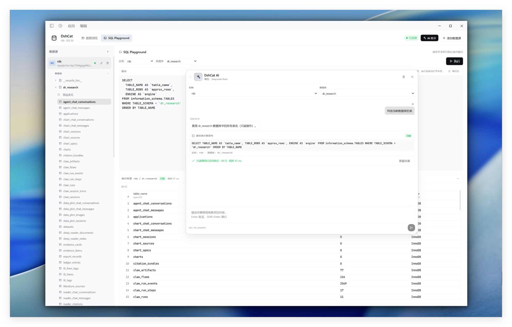
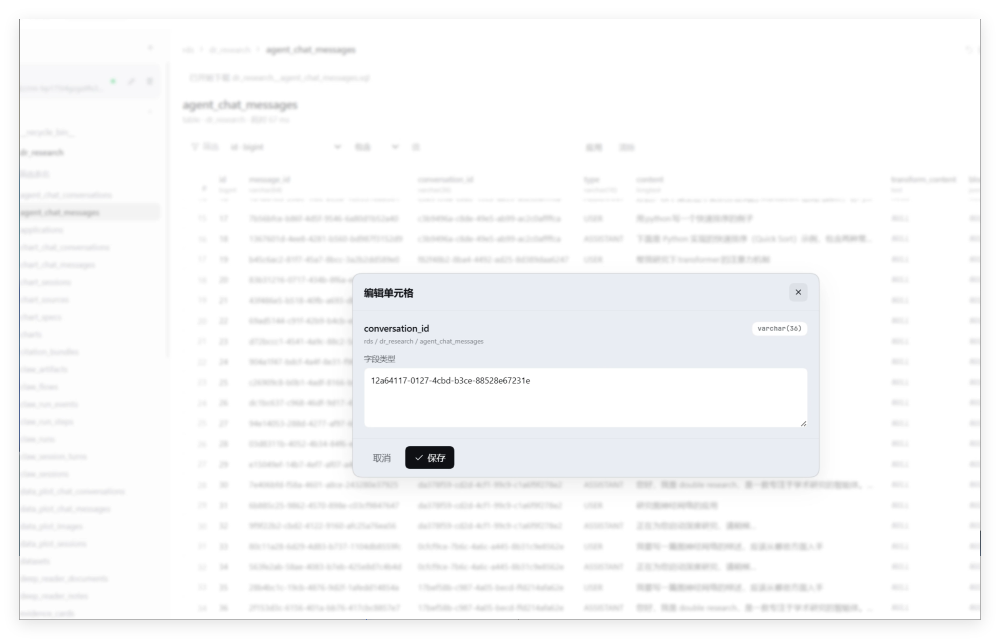

# Dsh-Data-Cat

[English](README.md) | **简体中文**

[](LICENSE)
[](#环境要求)
[](#安装)
[](#支持矩阵)
[](#参与贡献)

Dsh-Data-Cat 是一个 **DeepSeek Harness (DSH) 插件**，可在 DSH Web 或 DeepSeek Harness Desktop（deepseek-harness-app）中使用，在左侧栏提供 Navicat 风格的数据库工作台。支持 MySQL、PostgreSQL、Redis 和 Elasticsearch，包含表数据浏览、单元格编辑与撤销、数据库管理、SQL Playground、数据导出和页面内的 AI 助手。

数据库连接只发生在 DSH Host；浏览器通过 DSH 同源签名会话调用 Host API。

## 界面预览

<table>
  <tr>
    <td width="50%" align="center">
      <a href="img/img1.png"></a><br>
      <sub>SQL Playground 与 AI 助手</sub>
    </td>
    <td width="50%" align="center">
      <a href="img/img2.png"></a><br>
      <sub>AI 助手生成并执行只读查询</sub>
    </td>
  </tr>
  <tr>
    <td width="50%" align="center">
      <a href="img/img3.png"></a><br>
      <sub>连接 MySQL、PostgreSQL、Redis 或 Elasticsearch</sub>
    </td>
    <td width="50%" align="center">
      <a href="img/img4.png"></a><br>
      <sub>按字段类型编辑单元格，并显示主键上下文</sub>
    </td>
  </tr>
  <tr>
    <td width="50%" align="center">
      <a href="img/img5.png"></a><br>
      <sub>生成的 SQL 与执行结果</sub>
    </td>
    <td width="50%" align="center">
      <a href="img/img6.png"></a><br>
      <sub>表数据浏览、筛选与分页</sub>
    </td>
  </tr>
</table>

<sub>截图拍摄于更名前，界面中的部分名称仍显示为 DshCat。</sub>

## 功能

### 连接与浏览

- 在侧栏添加 MySQL、PostgreSQL、Redis、Elasticsearch 数据源，支持 URL、用户名、密码和可选默认数据库。
- 按「实例 → 数据库 → 表」浏览；点击数据库展开表列表，再次点击收起。
- 点击列头可快速定位筛选字段；支持上一页/下一页，默认每页 100 行，可切换 50/100/200 行。
- 表列表支持按名称筛选；数据表格展示字段类型和主键信息。

### 数据库管理

- MySQL/PostgreSQL 连接实例支持新建数据库。
  - MySQL：`utf8mb4`，排序规则 `utf8mb4_unicode_ci`。
  - PostgreSQL：`UTF8`。
- 可删除当前数据库，但必须二次确认，完整输入 `确认删除<数据库名>` 后才启用删除按钮。
- 系统数据库受保护，界面禁用删除，Host API 和 SQL Playground 中的 `DROP DATABASE` 也会被拒绝。
  - MySQL：`mysql`、`information_schema`、`performance_schema`、`sys`
  - PostgreSQL：`postgres`、`template0`、`template1`

### 数据表格

- 配置字段筛选、翻页、按列头定位筛选字段。
- 双击 MySQL/PostgreSQL 表的单元格可编辑：
  - 数字、布尔、MySQL enum、日期时间、JSON/数组、普通文本使用对应控件。
  - 可空字段可显式写入 `NULL`。
  - 编辑器展示字段类型、主键标记和当前实例/数据库/表。
- 每张表保留最近 3 次手动单元格修改；表格工具栏的「撤销」按钮按从新到旧恢复，按钮上的数字表示剩余次数。
- 单元格编辑按主键定位行，支持复合主键；无主键表、视图、二进制字段和 Redis/Elasticsearch 虚拟表不支持直接编辑。

### SQL Playground

- 使用当前实例和当前数据库；未选中文本时执行全部，选中文本时只执行选中部分。
- `Ctrl/Cmd + Enter` 执行；结果区可拖动调整高度、最小化。
- SQL 编辑区提供语法高亮，HTML 覆盖层与原生 textarea 同步滚动，不改变选择、输入和粘贴行为。
- MySQL/PostgreSQL 下提供「格式化」按钮：有选区时格式化选区，否则格式化全部。
- 执行前会判断风险：写入、DDL 和 Redis 删除类命令需要二次确认；结果显示最多 2,000 行。
- 结果会记录来源实例/数据库；切换上下文后仍显示旧结果时会提示。

### AI 助手

- AI 入口和对话窗口都只在 Dsh-Data-Cat 页面内显示，不会出现在其他会话页面。
- 对话框支持拖动标题栏移动、拖动四角缩放；窄屏下固定为面板底部的对话框。
- 读取当前数据库结构及少量样例值，生成查询和风险说明。
- 只读查询自动执行并切换到 SQL Playground 显示结果；写入/高危操作需要确认。
- SQL 执行失败时，错误信息会写入 AI 对话历史（显示为执行错误事件），便于继续追问修复。
- 使用 DSH 当前的默认模型；AI 入口不会在页面外出现。

### 导出

- MySQL/PostgreSQL：导出当前表结构 SQL，或结构加数据 SQL。
- Redis：导出键值命令脚本。
- Elasticsearch：导出映射 JSON 或 NDJSON。
- 导出上限：SQL 数据 50,000 行；Redis 1,000 个键；Elasticsearch 10,000 条文档。到上限时文件内会注明。

## 支持矩阵

| 数据源 | 浏览表/数据 | 筛选与分页 | 单元格编辑 | 新建/删除数据库 | SQL 执行 | 导出 |
| --- | --- | --- | --- | --- | --- | --- |
| MySQL | 是 | 是 | 有主键表 | 是 | 是 | DDL / DDL+数据 |
| PostgreSQL | 是 | 是 | 有主键表 | 是 | 是 | DDL / DDL+数据 |
| Redis | Keys 虚拟表 | Key/类型筛选、分页 | 否 | 否 | Redis 命令 | 命令脚本 |
| Elasticsearch | 索引 / 文档虚拟表 | 分页 | 否 | 否 | SQL / JSON DSL | 映射 / NDJSON |

## 环境要求

- 支持 Cordis 插件的 DSH Web 或 DeepSeek Harness Desktop 版本。
- DSH Host 侧 Node.js 20 或更高版本。
- pnpm（仅安装/开发依赖时需要）。
- 本插件自带数据库驱动：`mysql2`、`pg`、`redis`、`@elastic/elasticsearch`。

## 安装

### 在 DeepSeek Harness Desktop（deepseek-harness-app）中安装

适用于官方 **DeepSeek Harness Desktop** 桌面应用，不需要单独使用 `dsh` 命令行。

1. 安装并打开 DeepSeek Harness Desktop。
2. 准备插件目录：

   ```sh
   git clone <仓库地址> dshcat
   cd dshcat
   pnpm install
   ```

   如果下载的是源码压缩包，解压后同样进入包含 `package.json` 的 `dshcat` 目录并执行 `pnpm install`。

3. 在 DeepSeek Harness Desktop 中打开 **Plugins（插件）** 页面，点击 **Add plugin（添加插件）**。
4. 选择 `dshcat` 目录（即包含 `package.json`、`cordis.patch.yml` 的目录），等待安装完成。
5. 确认 **Dsh-Data-Cat** 插件已启用；如果被禁用，在插件列表中启用它。
6. 新建一个会话，或刷新/重启应用。左侧栏会出现 **Dsh-Data-Cat** 入口。

安装使用的是本地目录链接，因此 **安装后不要移动或删除 `dshcat` 目录**；移动后需要在 Plugins 中移除并重新添加。依赖需要在目录内执行 `pnpm install`，升级后也建议重新执行一次。

### 从本地目录安装（通用）

如果使用 DSH Web 或自行管理 profile，也可以在 Plugins 中通过 **Add plugin** 选择本目录。内部 bundle 名称仍为 `@local/dshcat`，界面展示名为 **Dsh-Data-Cat**。安装后在新的会话/刷新页面打开 **Dsh-Data-Cat** 侧栏入口。

### 开发时更新

`client.js` 是直接由 DSH Web 客户端加载的浏览器 bundle，没有构建步骤。

1. 修改 `client.js`、`lib/` 等文件。
2. 在 Plugins 中重新加载/禁用再启用 Dsh-Data-Cat。
3. 刷新 DSH 页面，确保浏览器使用新的客户端 bundle。

## 快速开始

1. 打开左侧 **Dsh-Data-Cat → 添加数据源**。
2. 选择类型并填写连接 URL：

```text
mysql://localhost:3306/app
postgresql://localhost:5432/postgres
redis://localhost:6379/0
http://localhost:9200
```

用户名和密码可以留空；Redis 的 `/0` 是数据库编号，不是路径。

3. 保存并连接后，选择数据库和表。
4. 在 SQL Playground 中执行 SQL，或点击页面顶部「AI 助手」描述需求。

> Redis 默认端口是 **6379**。如果连接被拒绝，先确认服务已启动且端口正确；插件会在错误横幅中显示目标地址和具体原因。

## 数据存储与安全

- 数据源配置保存在 Host 本机：

  ```text
  DSH_HOME/dshcat/datasources.json
  ```

  默认 `DSH_HOME` 为 `~/.dsh`。
- **密码和 URL 中的凭据以明文保存在该文件**。请限制文件权限，不要提交到 Git、同步盘或截图。
- 浏览器只拿到脱敏后的数据源信息；数据库连接和凭据使用都发生在 Host。
- AI 请求会把当前实例/数据库的结构、所选表的少量样例数据（Redis 键值预览、Elasticsearch 样本文档）发送给当前 DSH 默认模型。敏感数据请先切换到脱敏数据库，或不要使用 AI。
- 写入、DDL 和 Redis 删除命令在真正执行前需要确认；但用户仍应对自己的数据库负责。
- `DROP DATABASE` 系统库会被 Host 拒绝，即使通过 SQL Playground 或 AI 生成语句也是如此。

## 代码结构

```text
dshcat/
├── index.js                 Host 半入口：注册 /api/dshcat
├── lib/
│   ├── api.js               认证 API 分发、参数校验、结果上限
│   ├── ai.js                AI 提示词、schema 上下文、模型调用
│   ├── store.js             DSH_HOME/dshcat/datasources.json 读写
│   ├── sql.js               标识符引用、筛选、风险判断、SQL/Redis 字面量
│   ├── url.js               URL 解析、脱敏、连接信息
│   └── adapters/            MySQL / PostgreSQL / Redis / Elasticsearch 适配器
├── client.js                Web 客户端 bundle（UI、store、SQL 编辑器、AI 面板）
├── locale/                 插件列表的中英文元数据
├── img/                    README 展示截图
├── icon.svg                侧栏图标
├── cordis.patch.yml        DSH bundle 插入点
├── scripts/check.mjs       全量 JavaScript 语法检查
├── package.json
├── LICENSE                 MIT 许可证
├── README.md               英文 README（默认）
└── README.zh.md            中文 README
```

- `client.js` 是单文件浏览器 bundle，使用 `React.createElement` 和原生 CSS，不依赖构建链。
- UI 文案集中在 `client.js` 的 `COPY` 表；插件商店/列表描述在 `locale/*.json`。新增功能时两处需同步。
- 适配器实现统一契约，新增数据库类型时在 `lib/adapters/index.js` 注册。
- 浏览器不直接 `require` 数据库驱动；所有驱动依赖都在 Host 半使用。

## 开发

```sh
pnpm install
pnpm check
```

`pnpm check` 会对仓库内所有 JavaScript 文件执行 `node --check`，不启动数据库或 DSH。

当前仓库不包含数据库集成测试；修改适配器后建议准备临时 MySQL/PostgreSQL/Redis/Elasticsearch 实例做一次连接、查询、导出回归。

提交前请确认：

- 没有把 `node_modules/`、`.tmp*`、日志、`.env` 或 `datasources.json` 加入版本库。
- `client.js` 保持浏览器可直接加载，不引入 Node 内置模块（`fs`、`path` 等）。
- 新增 UI 使用 DSH 主题 token（`--dsw-*`），不要写死亮色/暗色值。
- 修改数据源/凭据逻辑时同步更新本 README 的安全说明。

## 已知限制

- 仅 MySQL/PostgreSQL 支持单元格编辑和数据库新建/删除；编辑依赖主键，二进制字段只读。
- 单元格撤销栈只保存在当前浏览器会话，刷新页面或重载插件后清空；不检测期间是否有其他 SQL 修改过同一单元格。
- PostgreSQL 表结构导出包含列、默认值和主键，不完整导出外键、触发器、自定义类型定义。
- SQL 结果是单次展示上限（2,000 行），不影响导出；导出也有各自上限。
- Redis 通过 `SCAN` 读取键；键空间变化时页码顺序可能变化。键筛选支持包含/等于，类型筛选支持等于。
- Elasticsearch SQL 需要目标集群启用 SQL 功能；也可以在当前索引使用 JSON DSL。
- Redis 把 `db0`、`db1`… 显示为数据库，把 `Keys` 显示为虚拟表；Elasticsearch 把索引显示为数据库，把 `Documents` 显示为虚拟表。
- 暂无 SSH 隧道、SSL 证书文件选择、连接池管理界面；SSL 通过 URL 的 `sslmode` / `tls` 参数表达。
- SQL 格式化是轻量级格式化器，不是完整 SQL 解析器；格式化后建议快速检查复杂语句。
- AI 助手只在 Dsh-Data-Cat 页面内可用，依赖 DSH 默认模型配置。

## 常见问题

### Redis 连接失败 / `ECONNREFUSED`

先确认 Redis 已启动，再检查 URL 端口。默认端口是 `6379`，不是 `3679`。插件现在会显示实际目标和连接错误原因。

### MySQL/PostgreSQL 连接失败

检查 Host、端口、防火墙、用户名/密码权限，以及默认数据库是否存在；数据库不存在时请留空默认数据库或先创建。

### AI 助手没有出现

AI 入口只在 Dsh-Data-Cat 页面顶部。确认已配置 DSH 默认模型，并在当前页面选择实例和数据库。

### 修改后页面没有变化

在 Plugins 中重新加载 Dsh-Data-Cat，然后刷新页面。客户端 bundle 会随页面加载，单纯刷新插件状态不一定替换已加载的 JS。

## 参与贡献

欢迎提交 Issue 和 Pull Request。

- 提交前请运行 `pnpm check`。
- 不要提交 `node_modules/`、`.tmp*`、`.env` 或任何 `datasources.json`。
- 修改数据库适配器或凭据逻辑时，请同步更新 README 的安全说明。
- 提交 Pull Request 时请说明变更目的、影响的数据源以及已验证的范围。

## GitHub Topics

建议在 GitHub 仓库的 **About → Topics** 中使用以下标签：

```text
dsh
dsh-plugin
deepseek-harness
database-manager
mysql
postgresql
redis
elasticsearch
sql-editor
ai
```

## 许可

本项目使用 [MIT License](LICENSE) 开源。

```text
Copyright (c) 2026 Dsh-Data-Cat contributors
```
