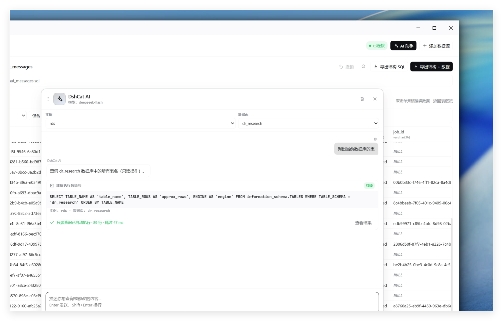
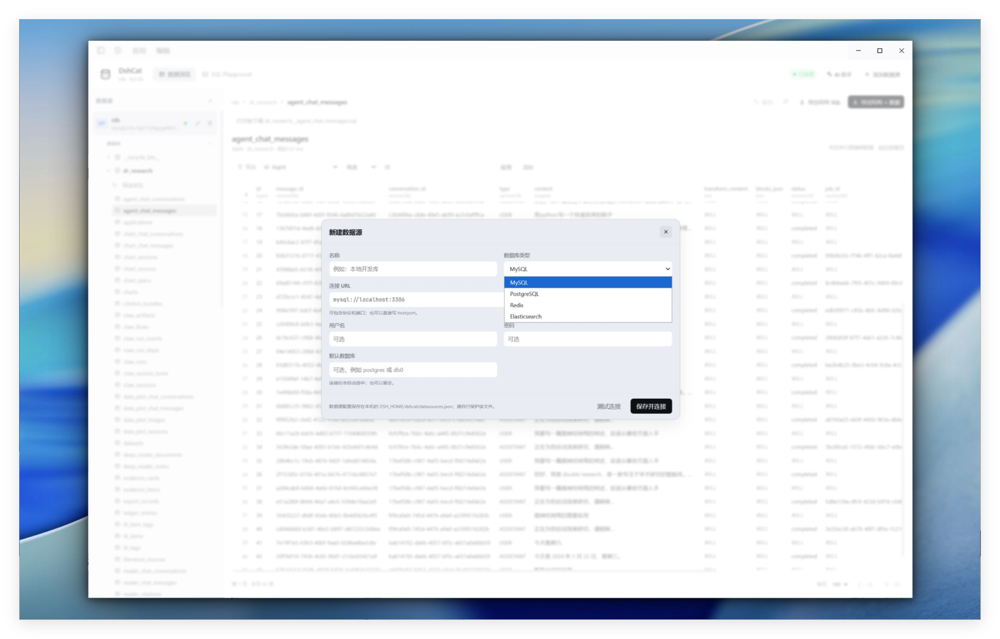
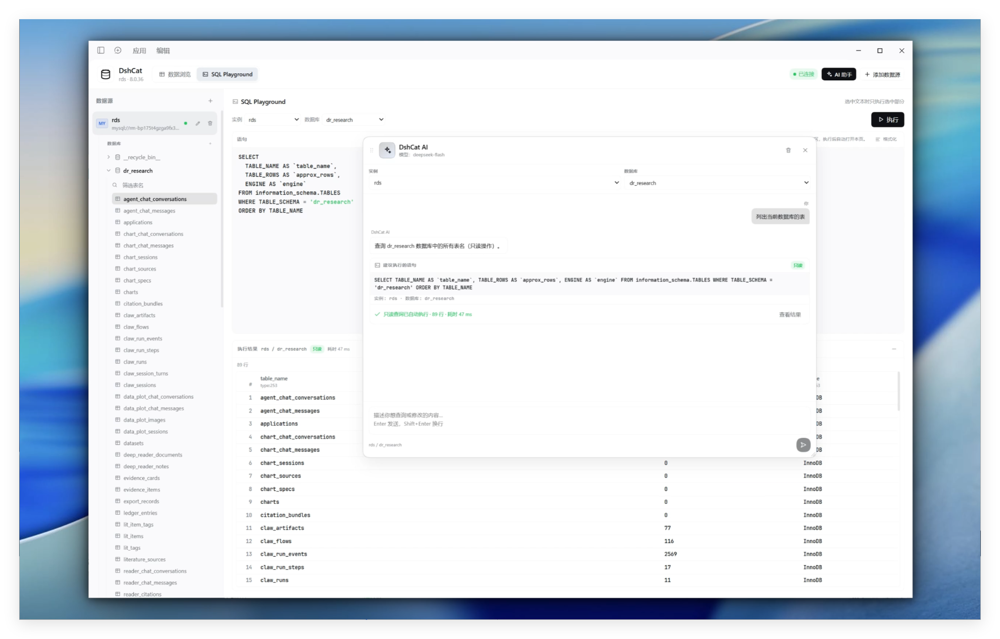
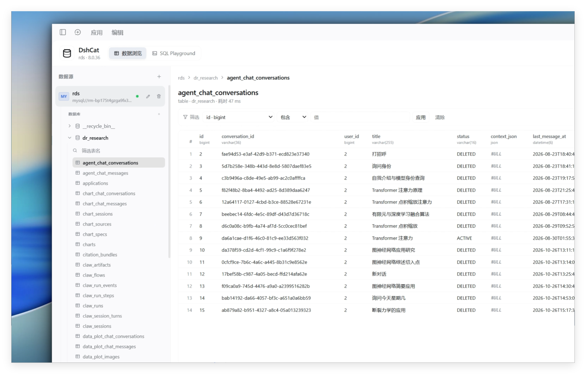

# DshDataCat

[English](README.md) | **简体中文**

[](LICENSE)
[](#环境要求)
[](#安装)
[](#支持矩阵)
[](#参与贡献)

DshDataCat 是一个 **DeepSeek Harness (DSH) 插件**，可在 DSH Web 或 DeepSeek Harness Desktop（deepseek-harness-app）中使用，在左侧栏提供 Navicat 风格的数据库工作台。支持 MySQL、PostgreSQL、Redis 和 Elasticsearch，包含表数据浏览与排序、稳定分页、待提交事务式单元格编辑、数据库管理、SQL Playground、界面与 Agent 导出、schema diff 预览和页面内的 AI 助手。

数据库连接只发生在 DSH Host；浏览器通过 DSH 同源签名会话调用 Host API。

## 界面预览

<table>
  <tr>
    <td width="50%" align="center">
      <a href="img/img1.png"></a><br>
      <sub>SQL Playground 与 AI 助手</sub>
    </td>
    <td width="50%" align="center">
      <a href="img/img2.png"></a><br>
      <sub>AI 助手生成并执行只读查询</sub>
    </td>
  </tr>
  <tr>
    <td width="50%" align="center">
      <a href="img/img3.png"></a><br>
      <sub>连接 MySQL、PostgreSQL、Redis 或 Elasticsearch</sub>
    </td>
    <td width="50%" align="center">
      <a href="img/img4.png"></a><br>
      <sub>按字段类型编辑单元格，并显示主键上下文</sub>
    </td>
  </tr>
  <tr>
    <td width="50%" align="center">
      <a href="img/img5.png"></a><br>
      <sub>生成的 SQL 与执行结果</sub>
    </td>
    <td width="50%" align="center">
      <a href="img/img6.png"></a><br>
      <sub>表数据浏览、筛选与分页</sub>
    </td>
  </tr>
</table>

<sub>截图拍摄于更名和表格排序/待提交编辑/Agent 工具更新之前，界面中的部分名称仍显示为 DshCat。</sub>

## 亮点

- 按真实列排序，自动追加主键作为稳定次级键；无主键表在 PostgreSQL 使用 `ctid`、MySQL 使用全列排序。
- 估算行数 + 精确计数按钮；列元数据缓存 10 秒，DDL 后失效。
- 单元格修改先进入待提交区，显示 SQL 预览，单事务提交，失败整批回滚。
- DSH Agent 工具覆盖查询、元数据、CSV/XLSX 导出、Markdown 数据字典，以及可审查的 schema diff/ALTER 预览。

## 功能

### 连接与浏览

- 在侧栏添加 MySQL、PostgreSQL、Redis、Elasticsearch 数据源，支持 URL、用户名、密码和可选默认数据库。
- 按「实例 → 数据库 → 表」浏览；点击数据库展开表列表，再次点击收起。
- 点击列头排序；点击列头旁的漏斗图标快速定位该字段筛选。支持上一页/下一页，默认每页 100 行，可切换 50/100/200 行。
- 表列表支持按名称筛选；数据表格展示字段类型和主键信息。

### 数据库管理

- MySQL/PostgreSQL 连接实例支持新建数据库。
  - MySQL：`utf8mb4`，排序规则 `utf8mb4_unicode_ci`。
  - PostgreSQL：`UTF8`。
- 可删除当前数据库，但必须二次确认，完整输入 `确认删除<数据库名>` 后才启用删除按钮。
- 系统数据库受保护，界面禁用删除，Host API 和 SQL Playground 中的 `DROP DATABASE` 也会被拒绝。
  - MySQL：`mysql`、`information_schema`、`performance_schema`、`sys`，以及阿里云 RDS 的 `__recycle_bin__`
  - PostgreSQL：`postgres`、`template0`、`template1`

### 数据表格

- 字段筛选和分页。点击列头循环切换升序 → 降序 → 默认；点击列头旁的漏斗图标快速筛选取该字段。
- 排序字段会按真实列白名单校验，并自动追加主键作为稳定排序的次级键。
- 有主键的表按主键分页；无主键 PostgreSQL 表使用 `ctid`，无主键 MySQL 表使用全列排序。两者都会提示并发写入可能导致 offset 分页漏行/重复。
- 无筛选时在标题区显示估算行数（`TABLE_ROWS` / `reltuples`），并提供「精确计数」按钮；精确计数会带上当前筛选条件。
- 列元数据按「数据源 + 数据库 + 表」缓存 10 秒，DDL 后主动失效。
- 双击 MySQL/PostgreSQL 表的单元格可暂存修改：
  - 数字、布尔、MySQL enum、日期时间、JSON/数组、普通文本使用对应控件。
  - 可空字段可显式写入 `NULL`。
  - 编辑器展示字段类型、主键标记和当前实例/数据库/表。
  - 修改先进入「待提交」区，并实时显示将要执行的 `UPDATE` SQL。
  - 点击「提交修改」会在一个事务中执行整批修改，失败整体回滚；「放弃」恢复上次加载的数据。
  - 待提交模式不支持修改主键字段；无主键表、视图、二进制字段和 Redis/Elasticsearch 虚拟表仍不可编辑。

### SQL Playground

- 使用当前实例和当前数据库；未选中文本时执行全部，选中文本时只执行选中部分。
- `Ctrl/Cmd + Enter` 执行；结果区可拖动调整高度、最小化。
- SQL 编辑区提供语法高亮，HTML 覆盖层与原生 textarea 同步滚动，不改变选择、输入和粘贴行为。
- MySQL/PostgreSQL 下提供「格式化」按钮：有选区时格式化选区，否则格式化全部。
- SQL 会先按顶层分号切分，再逐条分类、逐条执行，并放在同一个事务里；不会再作为整串多语句直接交给驱动。MySQL 已关闭 `multipleStatements`。
- 只读批次使用引擎级只读事务（`START TRANSACTION READ ONLY` / `BEGIN TRANSACTION READ ONLY`），并受每数据源语句超时约束（默认 15 秒）。`classifyRisk` 只是 UX 提示，安全边界在数据库引擎。
- 执行前会判断风险：写入、DDL 和 Redis 删除类命令需要二次确认；结果行数受数据源策略限制（默认 2,000 行）。
- 结果会记录来源实例/数据库；切换上下文后仍显示旧结果时会提示。

### AI 助手

- AI 入口和对话窗口都只在 DshDataCat 页面内显示，不会出现在其他会话页面。
- 对话框支持拖动标题栏移动、拖动四角缩放；窄屏下固定为面板底部的对话框。
- 默认只读取数据库结构；样例值默认不发送。显式开启 `aiSampleData` 后，password、token、email、phone、secret 等字段会按列名脱敏。
- 只读查询自动执行并切换到 SQL Playground 显示结果；写入/高危操作需要确认。
- SQL 执行失败时，错误信息会写入 AI 对话历史（显示为执行错误事件），便于继续追问修复。
- 使用 DSH 当前的默认模型；AI 入口不会在页面外出现。

### 导出

- MySQL/PostgreSQL：导出当前表结构 SQL，或结构加数据 SQL。
- Redis：导出键值命令脚本。
- Elasticsearch：导出映射 JSON 或 NDJSON。
- 导出上限：SQL 数据 50,000 行；Redis 1,000 个键；Elasticsearch 10,000 条文档。到上限时文件内会注明。

## 支持矩阵

| 数据源 | 浏览表/数据 | 筛选与分页 | 单元格编辑 | 新建/删除数据库 | SQL 执行 | 导出 |
| --- | --- | --- | --- | --- | --- | --- |
| MySQL | 是 | 是 | 有主键表 | 是 | 是 | DDL / DDL+数据 |
| PostgreSQL | 是 | 是 | 有主键表 | 是 | 是 | DDL / DDL+数据 |
| Redis | Keys 虚拟表 | Key/类型筛选、分页 | 否 | 否 | Redis 命令 | 命令脚本 |
| Elasticsearch | 索引 / 文档虚拟表 | 分页 | 否 | 否 | SQL / JSON DSL | 映射 / NDJSON |

## Agent 工具

DshDataCat 把同一套 Host 操作注册成 DSH 工具（DSH 工具名使用下划线）：

- `db_list_sources` — 数据源名称、类型、默认库、密码状态和策略。
- `db_list_tables` — 数据库列表，或指定库的表；会应用数据源 allowlist。
- `db_describe` — MySQL/PostgreSQL 表的字段、类型、可空、默认值和主键。
- `db_query` — 与界面相同的切分/分类/执行/策略/只读事务/超时/行数上限/审批/审计链路。
- `db_data_dictionary` — 为单表或最多 50 张表生成 Markdown 数据字典，写入 Agent 工作区。
- `db_export` — 执行只读查询，把第一个结果集写成工作区内的 UTF-8 CSV 或 XLSX，返回可直接传给 `present` 的相对路径。
- `db_schema_diff` — 比较两个同类型数据源的表集合、列、索引和约束，生成需人工审查的 `ALTER` 预览；省略 `table_a` 时只比较表名集合。索引差异会生成 CREATE/DROP INDEX，PostgreSQL 约束可生成 ADD/DROP CONSTRAINT，MySQL 约束仅报告差异；不会执行，触发器暂未覆盖。

只有一个数据源时 `source` 可省略。写入类 `db_query` 在 Agent 发起时会走 Agent 审批通道；没有可用审批通道时不会静默写入。导出路径限制在 Agent 工作区内，并拒绝路径穿越。

## 环境要求

- 支持 Cordis 插件的 DSH Web 或 DeepSeek Harness Desktop 版本。
- DSH Host 侧 Node.js 20 或更高版本。
- pnpm（仅安装/开发依赖时需要）。
- 本插件自带数据库驱动：`mysql2`、`pg`、`redis`、`@elastic/elasticsearch`，以及 XLSX 导出使用的 `xlsx`。

## 安装

### 在 DeepSeek Harness Desktop（deepseek-harness-app）中安装

适用于官方 **DeepSeek Harness Desktop** 桌面应用，不需要单独使用 `dsh` 命令行。

1. 安装并打开 DeepSeek Harness Desktop。
2. 准备插件目录：

   ```sh
   git clone <仓库地址> dshcat
   cd dshcat
   pnpm install
   ```

   如果下载的是源码压缩包，解压后同样进入包含 `package.json` 的 `dshcat` 目录并执行 `pnpm install`。

3. 在 DeepSeek Harness Desktop 中打开 **Plugins（插件）** 页面，点击 **Add plugin（添加插件）**。
4. 选择 `dshcat` 目录（即包含 `package.json`、`cordis.patch.yml` 的目录），等待安装完成。
5. 确认 **DshDataCat** 插件已启用；如果被禁用，在插件列表中启用它。
6. 新建一个会话，或刷新/重启应用。左侧栏会出现 **DshDataCat** 入口。

安装使用的是本地目录链接，因此 **安装后不要移动或删除 `dshcat` 目录**；移动后需要在 Plugins 中移除并重新添加。依赖需要在目录内执行 `pnpm install`，升级后也建议重新执行一次。

### 从本地目录安装（通用）

如果使用 DSH Web 或自行管理 profile，也可以在 Plugins 中通过 **Add plugin** 选择本目录。内部 bundle 名称仍为 `@local/dshcat`，界面展示名为 **DshDataCat**。安装后在新的会话/刷新页面打开 **DshDataCat** 侧栏入口。

### 开发时更新

`client.js` 是直接由 DSH Web 客户端加载的浏览器 bundle，没有构建步骤。

1. 修改 `client.js`、`lib/` 等文件。
2. 在 Plugins 中重新加载/禁用再启用 DshDataCat。
3. 刷新 DSH 页面，确保浏览器使用新的客户端 bundle。

## 快速开始

1. 打开左侧 **DshDataCat → 添加数据源**。
2. 选择类型并填写连接 URL：

```text
mysql://localhost:3306/app
postgresql://localhost:5432/postgres
redis://localhost:6379/0
http://localhost:9200
```

用户名和密码可以留空；Redis 的 `/0` 是数据库编号，不是路径。

3. 保存并连接后，选择数据库和表。
4. 在 SQL Playground 中执行 SQL，或点击页面顶部「AI 助手」描述需求。

> Redis 默认端口是 **6379**。如果连接被拒绝，先确认服务已启动且端口正确；插件会在错误横幅中显示目标地址和具体原因。

## 数据存储与安全

- 非密数据源配置保存在 Host 本机：

  ```text
  DSH_HOME/dshcat/datasources.json
  ```

  默认 `DSH_HOME` 为 `~/.dsh`。
- 密码和 URL 中的凭据作为不透明记录存入 DSH 凭据服务（`ctx.credentials`），引用格式为 `dshcat/<source-id>`。`datasources.json` 只保留引用，不再包含明文密码；旧版明文密码会在首次加载时迁移并从 JSON 文件移除。
- 凭据本地 provider 仍会写入当前系统用户可读的文件（通常是 `~/.dsh/.credentials.yaml`）。这一步解决的是密码不散落在插件数据、不会随配置同步泄漏；它不是对同用户恶意进程的隔离。
- 浏览器只拿到脱敏后的数据源信息和 `hasPassword` 状态，拿不到密码或凭据值。
- AI 默认只接收 schema；`aiSampleData` 需显式开启，并且敏感列名会被脱敏。Redis 键值预览和 Elasticsearch 样本文档遵循同一策略。
- SQL 按语句切分并逐条分类执行。MySQL/PostgreSQL 的只读批次使用引擎级只读事务和语句超时；MySQL 已关闭 `multipleStatements`。
- `LOAD_FILE`、PostgreSQL 文件读取函数、`COPY ... PROGRAM`、`INTO OUTFILE` 等危险读函数归为 danger；`DROP SCHEMA public CASCADE` 和受保护数据库的删除会被拒绝或要求显式批准。
- 写入、DDL 和 Redis 删除命令执行前需要确认。请求由 Agent 发起时使用 `ctx.approval` 的一次性审批；浏览器发起的写入使用带签名的页面内确认。
- 每次 SQL 执行都会向 `DSH_HOME/dshcat/audit.jsonl` 写入不含秘密的 JSONL 审计记录（数据源、数据库、风险、耗时、审批状态、语句哈希）。驱动错误详情只写 Host 日志，浏览器收到通用错误信息。

## 每数据源策略

每个数据源可在 `datasources.json` 中携带非密策略：

```json
{
  "readOnly": false,
  "statementTimeoutMs": 15000,
  "maxRows": 2000,
  "allowedDatabases": [],
  "aiEnabled": true,
  "aiSampleData": false
}
```

| 字段 | 默认值 | 作用 |
| --- | --- | --- |
| `readOnly` | `false` | 拒绝 SQL 写入、数据库管理和单元格修改 |
| `statementTimeoutMs` | `15000` | 单条语句超时（1–120 秒） |
| `maxRows` | `2000` | SQL 结果集和表分页上限（1–10,000） |
| `allowedDatabases` | `[]` | 空表示全部；否则隐藏并拒绝其他数据库 |
| `aiEnabled` | `true` | 是否为该数据源启用 AI 助手 |
| `aiSampleData` | `false` | 是否允许脱敏样例值进入 AI 上下文 |

策略统一在 Host dispatch 入口检查，不散落在各 adapter 中。

## 代码结构

```text
dshcat/
├── index.js                 Host 半入口：注册 /api/dshcat
├── lib/
│   ├── api.js               API 分发、策略、待提交编辑、Agent 工具、导出/schema diff
│   ├── ai.js                AI 提示词、schema 上下文、模型调用
│   ├── audit.js             不含秘密的 JSONL 执行审计
│   ├── store.js             数据源元数据 + ctx.credentials 引用/策略
│   ├── sql.js               标识符、筛选、风险判断、语句切分
│   ├── url.js               URL 解析、脱敏、连接信息
│   └── adapters/            MySQL / PostgreSQL / Redis / Elasticsearch 适配器
├── client.js                Web 客户端 bundle（UI、store、SQL 编辑器、AI 面板）
├── locale/                 插件列表的中英文元数据
├── img/                    README 展示截图
├── icon.svg                侧栏图标
├── cordis.patch.yml        DSH bundle 插入点
├── scripts/check.mjs       全量 JavaScript 语法检查
├── tests/                  安全边界、表格层与待提交编辑测试
├── package.json
├── LICENSE                 MIT 许可证
├── README.md               英文 README（默认）
└── README.zh.md            中文 README
```

- `client.js` 是单文件浏览器 bundle，使用 `React.createElement` 和原生 CSS，不依赖构建链。
- UI 文案集中在 `client.js` 的 `COPY` 表；插件商店/列表描述在 `locale/*.json`。新增功能时两处需同步。
- 适配器实现统一契约，新增数据库类型时在 `lib/adapters/index.js` 注册。
- 浏览器不直接 `require` 数据库驱动；所有驱动依赖都在 Host 半使用。

## 开发

```sh
pnpm install
pnpm check
pnpm test
```

`pnpm check` 会对仓库内所有 JavaScript 文件执行 `node --check`。`pnpm test` 覆盖语句切分、对抗性风险分类、系统库/结构保护、策略归一化、凭据迁移、只读事务、查询超时、表格排序、元数据缓存，以及待提交编辑的预览/提交/回滚。

当前仓库不包含真实数据库集成测试（尚未接入 testcontainers）；修改适配器后建议准备临时 MySQL/PostgreSQL/Redis/Elasticsearch 实例，做连接、查询、待提交编辑、导出和 Agent 工具回归。`db_export` 的 XLSX 输出依赖随插件安装的 `xlsx`。

提交前请确认：

- 没有把 `node_modules/`、`.tmp*`、日志、`.env` 或 `datasources.json` 加入版本库。
- `client.js` 保持浏览器可直接加载，不引入 Node 内置模块（`fs`、`path` 等）。
- 新增 UI 使用 DSH 主题 token（`--dsw-*`），不要写死亮色/暗色值。
- 修改数据源/凭据逻辑时同步更新本 README 的安全说明。

## 已知限制

- 仅 MySQL/PostgreSQL 支持单元格编辑和数据库新建/删除；编辑依赖主键，二进制字段和待提交模式下的主键字段只读。
- 待提交修改只保存在当前页面状态，刷新页面或重载插件后丢失。存在待提交修改时会阻止翻页、排序、筛选和切换表，直到提交或放弃；同一行的并发修改仍可能竞争，当前提交事务尚未使用乐观锁/行版本。
- 精确计数在超大表上可能较慢；估算值用于避免每次翻页都做全表 COUNT。
- PostgreSQL 表结构导出包含列、默认值和主键，不完整导出外键、触发器、自定义类型定义。
- SQL 结果按数据源策略截断（默认 2,000 行）。截断发生在驱动返回数据之后，尚未使用流式游标；超大结果集仍会先在 Host 内存中生成再截断。导出上限另计。
- MySQL 记录写入放在一个事务中，但 MySQL DDL 可能隐式提交；一批 DDL 中途失败时，之前的 DDL 仍可能已生效。PostgreSQL DDL 可事务回滚。
- Redis 和 Elasticsearch 没有引擎级只读事务。其读路径依赖风险分类、`readOnly` 策略以及 Elasticsearch SQL 本身的只读 API，但没有 MySQL/PostgreSQL 的事务保证。
- Redis 通过 `SCAN` 读取键；键空间变化时页码顺序可能变化。键筛选支持包含/等于，类型筛选支持等于。
- Elasticsearch SQL 需要目标集群启用 SQL 功能；也可以在当前索引使用 JSON DSL。
- Redis 把 `db0`、`db1`… 显示为数据库，把 `Keys` 显示为虚拟表；Elasticsearch 把索引显示为数据库，把 `Documents` 显示为虚拟表。
- 暂无 SSH 隧道、SSL 证书文件选择、连接池管理界面；SSL 通过 URL 的 `sslmode` / `tls` 参数表达。
- SQL 格式化是轻量级格式化器，不是完整 SQL 解析器；格式化后建议快速检查复杂语句。
- AI 助手只在 DshDataCat 页面内可用，依赖 DSH 默认模型配置。
- 数据源策略由 Host 执行，但尚无专用 UI 编辑器；可通过 `datasources.json` 或 API 修改。
- 浏览器发起的写入使用带签名的页面内确认；只有存在发起 Agent 时才使用官方 `ctx.approval` 通道。Agent 工具目前覆盖查询、元数据、CSV/XLSX 导出、数据字典和 schema diff；较少使用的界面操作尚未全部暴露为工具。
- Web 客户端仍是单个立即加载的 `client.js`；前端源码拆分/构建、流式导出尚未在本轮完成。
- Agent 工具目前覆盖查询、元数据发现、CSV/XLSX 导出、Markdown 数据字典，以及表集合/列/索引/约束级 schema diff；触发器比较尚未实现，缺失表迁移只报告不生成 CREATE/DROP。schema diff 只生成预览，不会自动执行。
- 尚未提供 testcontainers 四引擎集成测试；当前提交的是单元级安全测试。

## 常见问题

### Redis 连接失败 / `ECONNREFUSED`

先确认 Redis 已启动，再检查 URL 端口。默认端口是 `6379`，不是 `3679`。插件现在会显示实际目标和连接错误原因。

### 阿里云 RDS 的 `__recycle_bin__` 无法删除

`__recycle_bin__` 是阿里云 RDS for MySQL 回收站功能的系统数据库。即使账号拥有全局 `DROP` 权限，RDS 也会拒绝 `DROP DATABASE`。DshDataCat 现在会把它标记为系统库并禁用删除。请勿尝试删除；回收站内的表请通过 RDS 控制台或 `dbms_recycle.purge_table(...)` 处理。

### MySQL/PostgreSQL 连接失败

检查 Host、端口、防火墙、用户名/密码权限，以及默认数据库是否存在；数据库不存在时请留空默认数据库或先创建。

### AI 助手没有出现

AI 入口只在 DshDataCat 页面顶部。确认已配置 DSH 默认模型，并在当前页面选择实例和数据库。

### 修改后页面没有变化

在 Plugins 中重新加载 DshDataCat，然后刷新页面。客户端 bundle 会随页面加载，单纯刷新插件状态不一定替换已加载的 JS。

## 参与贡献

欢迎提交 Issue 和 Pull Request。

- 提交前请运行 `pnpm check` 和 `pnpm test`。
- 不要提交 `node_modules/`、`.tmp*`、`.env`、`datasources.json` 或 `.credentials.yaml`。
- 修改数据库适配器或凭据逻辑时，请同步更新 README 的安全说明。
- 提交 Pull Request 时请说明变更目的、影响的数据源以及已验证的范围。

## GitHub Topics

建议在 GitHub 仓库的 **About → Topics** 中使用以下标签：

```text
dsh
dsh-plugin
deepseek-harness
database-manager
mysql
postgresql
redis
elasticsearch
sql-editor
ai
```

## 许可

本项目使用 [MIT License](LICENSE) 开源。

```text
Copyright (c) 2026 DshDataCat contributors
```
